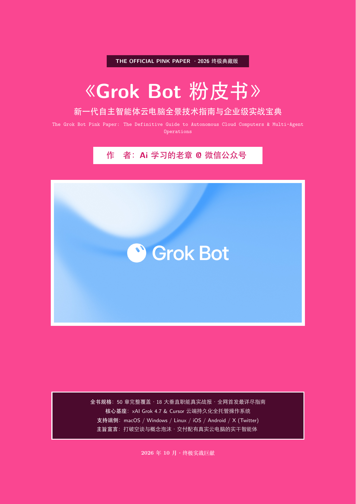

# 《Grok Bot 粉皮书》· The Grok Bot Pink Paper

**新一代自主智能体云电脑全景技术指南与企业级实战宝典**  
*The Definitive Guide to Autonomous Cloud Computers & Multi-Agent Operations*

---

## 📖 序言：为什么真男人要看粉皮书？

在当今的人工智能行业，桌面堆满了各种言之无物的“白皮书”、“蓝皮书”、“橙皮书”乃至“X皮书”。翻开那些装帧严肃的大部头报告，充斥其间的往往是空洞宏大的战略叙事、翻来覆去的术语堆砌以及缺乏工程落地的愿景图景。行业深陷概念泡沫太久，急需一种直面真实物理世界、敢于亮出生产代码与底层架构的硬核力量。

**这就是《Grok Bot 粉皮书》诞生的原因。**

为什么是粉色？在科技美学史上，粉色代表着对陈旧教条的叛逆、对传统冷色调技术官僚的解构，以及一种游刃有余的高维掌控力：
- **拒绝坐而论道，专注现场交付**：真正的技术实力体现于能否让智能体真正接管现实世界的复杂软件，能否在人类休眠时默默合并代码、处置工单、推进销售漏斗并守护网络安全；
- **粉色是硬核极客的浪漫**：在粉嫩鲜活的视觉外表之下，跳动的是 Linux 云电脑内核、端到端 TLS 深度检测、OpenTelemetry 工业级全链路遥测以及多智能体蜂群状态机；
- **真男人要看粉皮书**：褪去市面上千篇一律的伪装，直面生产级自主智能体的真实脉搏，这才是属于新一代 AI 原生工程师与组织领航者的实战宝典。

---

## 📦 交付物一览

| 文件名 | 格式说明 | 核心特色 |
| :--- | :--- | :--- |
| **[`grok_bot_pink_paper.pdf`](grok_bot_pink_paper.pdf)** | 终极典藏排版 PDF | 60 页粉色系豪华装帧、双语目录、矢量表格、超链接书签跳转 |
| **[`grok_bot_pink_paper.html`](grok_bot_pink_paper.html)** | 交互式长卷网页 | 暗夜极客粉（Cyberpunk Deep Rose）主题、粘性侧边栏 TOC、滚动进度条 |
| **[`grok_bot_pink_paper.md`](grok_bot_pink_paper.md)** | 全量 Markdown 原稿 | 4.6 万字纯干货、无删减 50 章完整架构、全部代码块与拓扑图开源 |
| **[`grok_bot_pink_paper.tex`](grok_bot_pink_paper.tex)** | XeLaTeX 源码 | 原生 `xeCJK` + `Songti SC` / `Heiti SC`，集成 `eso-pic` 全彩粉红装帧 |
| **[`真男人要看粉皮书：深度拆解 Grok Bot.md`](真男人要看粉皮书：深度拆解 Grok Bot.md)** | 传播推介技术长文 | 幽默犀利剖析 Grok Bot 六大技术壁垒，呼应粉皮书实干内核 |

---

## 🏛️ 全书 50 章十大核心板块导航

- **序言**：粉色力量与行动主义——解构概念泡沫的粉皮书宣言
- **第一部分：架构与计算基座篇（Architecture & Cloud Computer Base）**
  - 第1章：持久化云电脑底层架构剖析（Linux 容器沙箱、OverlayFS、NVMe 挂载）
  - 第2章：环境状态持久化与跨会话存储卷机制
  - 第3章：私有工作节点与本地 Mac mini 集群拓扑（反向安全隧道与 iOS 模拟器）
  - 第4章：人机接管、故障自愈与容灾重建（六级自愈状态机）
  - 第5章：新人入职向导与工作区侧边栏管理体系
- **第二部分：交互模型与全端触达篇（Interaction Paradigms & Access Channels）**
  - 第6章：Bot 解剖学与三要素元数据规范
  - 第7章：全端触达与移动端实时接管（iOS 灵动岛 Live Activities 与远程终端）
  - 第8章：实时双向双工语音通话（SpaceXSI 超低延迟音频流与虚拟 I/O 绑定）
  - 第9章：社交网络原生驱动与专属邮箱（Tag @bot on X 与 `@mail.grokbot.com`）
- **第三部分：例程引擎与自动化调度篇（Routines Engine & Automations）**
  - 第10章：例程系统底层架构（Instruction, When to run, Webhook）
  - 第11章：四维触发机制全景图（Cron、Slack/Email 入站、Webhook 鉴权、研发生态）
  - 第12章：离线 24/7 常驻自主执行与任务审计
  - 第13章：例程生命周期治理
- **第四部分：多智能体编排与群聊协作篇（Multi-Agent Orchestration & Channels）**
  - 第14章：从单聊到群聊的范式跃迁
  - 第15章：Stefan 与 Eric 的花名册法则与频道治理模型（One Project, One Channel, One Roster）
  - 第16章：Bot-to-Bot 串联流转与共享磁盘接力
  - 第17章：阻塞协议与人类升级机制（Blocked Escalation Protocol）
  - 第18章：外部敏捷看板双向联动（Notion 双数据库双向同步）
- **第五部分：连接器与混合操作生态篇（Connectors & Computer Use Ecosystem）**
  - 第19章：API 连接器与视觉操作的双轨混合策略
  - 第20章：官方全套连接器深度配置指南（GitHub, Linear, Slack, Notion, Salesforce 等）
  - 第21章：凭证管理与安全注入体系（Secret Vault 与临时安全表单）
- **第六部分：企业级安全、合规与网络治理篇（Security & Enterprise Governance）**
  - 第22章：交互式审批卡片（Approval Cards）与动态风控策略
  - 第23章：机密信息隔离与动态环境变量注入
  - 第24章：企业专属私有网络连接与 TLS 深度检测代理
  - 第25章：企业身份联邦与细粒度访问控制（SAML 2.0, SCIM, RBAC）
  - 第26章：OpenTelemetry 导出协议完整传输参考（Wire Reference 字典与 JSON 报文）
- **第七部分：业务职能实战手册（18 大场景深度实战）**
  - 第27章：SDR 销售拓客与智能冷启动流水线（Josh Allen, Contact Man, CLEAR vs FLAG 机制）
  - 第28章：企业日常运营与高管幕僚运行节奏
  - 第29章：法务运营与合同生命周期（Legal Ops）全流程
  - 第30章：研发工程团队与智能体集群实战（Baltata, Shaoruru, Hogan, Craig, Quill 与 Jenny）
  - 第31章：智能客户支持与工单流转（SupportGrok, Churn Clustering）
  - 第32章：创始人主导销售与早期管道孵化
  - 第33章：官方启动模板库与开箱即用 Prompt 架构
  - 第34章：多团队 Bot 编排治理（Projects Manager 调度中枢）
  - 第35章：移动端敏捷开发落地（iOS v0 3周上线复盘）
  - 第36章：设计团队与 Figma-to-Code 协同（Experiments, Motion God, Figma Bro, Devbot）
  - 第37章：GTM 跨职能战役协同网络
  - 第38章：产品经理（PM）全流程需求与用户洞察体系
  - 第39章：品牌营销与内容增长矩阵（六大营销智能体闭环）
  - 第40章：SpaceXSI 工程基建与文化（2000+ PRs 极速交付体系）
  - 第41章：效果营销与投放优化体系（多渠道 ROAS 巡检与预算再平衡）
  - 第42章：售后客户成功与客户健康度监控（Gus 幕僚长、晨报面板与暂存草稿箱）
  - 第43章：招聘与人才猎聘运营（人才雷达、胜任力初筛与日历排期）
  - 第44章：核心专属 Bot 源码与系统提示词深度拆解（Bot Boss, Inbox Manager, Nightly Audit Engineer, Loops Engine）
- **第八部分：市场生态与明星智能体解构篇（Marketplace Ecosystem）**
  - 第45章：Marketplace 架构与生态发布机制
  - 第46章：精选明星 Bot 深度全量解构（dr eggbot, Overheard, Tradbot 等 16 款标杆）
  - 第47章：八大垂直领域 Bot 分类全景图谱
- **第九部分：商业方案、订阅计费与选型指南篇（Plans, Billing & Packaging）**
  - 第48章：定价矩阵深度横向对比（Pro, Pro+, Ultra, Teams, Enterprise, SuperGrok）
  - 第49章：跨生态订阅打通机制（Link SuperGrok 与移动端 IAP 恢复）
  - 第50章：企业用量管控、配额刷新与账户注销 SOP
- **第十部分：终章与行动纲领（Conclusion & Action Protocol）**
  - 结语：从粉皮书看智能体计算时代的底层逻辑

---

## 📄 开源许可证

本项目基于 [MIT License](LICENSE) 开源发布。欢迎自由阅读、分发、部署与二次创作。
