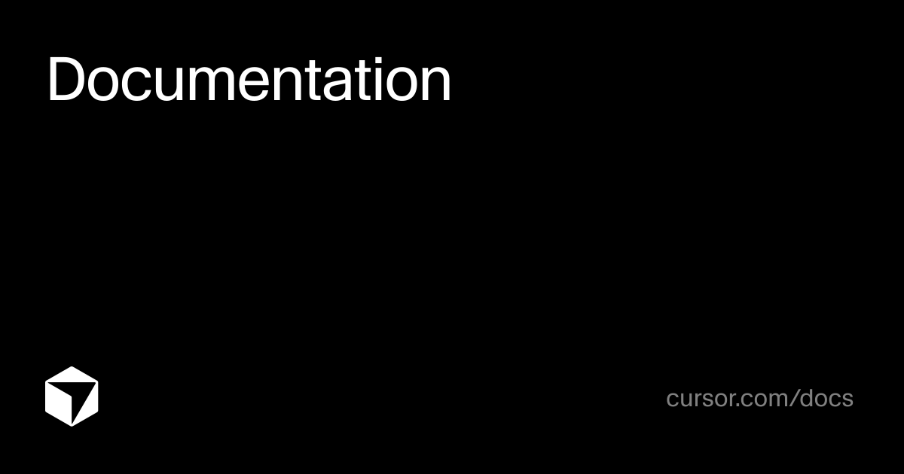

# 真男人要看粉皮书：深度拆解 xAI Grok Bot

> **作者**：Ai学习的老章@微信公众号  
> **发布日期**：2026年10月  
> **核心物料**：《Grok Bot 粉皮书》（已交付 HTML、Markdown 与 60 页精排 LaTeX PDF · 终极典藏版）  
> **开源仓库**：[https://github.com/tjxj/grok-bot-pink-paper](https://github.com/tjxj/grok-bot-pink-paper)  
> **PDF 下载**：[https://github.com/tjxj/grok-bot-pink-paper/releases/tag/v1.0.0](https://github.com/tjxj/grok-bot-pink-paper/releases/tag/v1.0.0)


---

市面上的“皮书”实在太多了。

打开朋友圈或者行业研报群，满眼都是各家大厂与咨询机构炮制的“白皮书”——动辄两百页，充斥着“生态协同、价值升维、底层赋能、范式跃迁”这类假大空的黑话；接着是国企与传统行业机构端出来的“蓝皮书”，摆着居高临下的姿态罗列宏观统计表格；再然后是 Web3 与投机圈子追捧的“橙皮书”，成天推演代币经济模型与庞氏流动性；还有各路机构生造出来的绿皮书、黑皮书、灰皮书与各类“X皮书”。

这些文件往往存在一个致命问题：通篇全是概念推演，一行能跑的真实配置都没有。读完以后除了脑仁疼，工作效率依然毫无长进。

今天，咱们彻底撕掉这些虚伪的行话伪装。

**真男人，要看粉皮书。**

为什么是粉皮书？在极客与硬核工程美学里，粉色代表纯粹的自信、撕裂教条的锋芒，以及拒绝概念忽悠的实干主义。

我们把 xAI 与 Cursor 刚刚发布的全部 182 份核心文档、一手工程指南与市场生态数据彻底扒光，汇编成了这本大而全的——**《Grok Bot 粉皮书》（The Pink Paper）**。

今天这篇文章，老章就带你把 Grok Bot 的技术骨架与实战打法彻底看透。

---

## 01 为什么说云电脑是 AI Agent 的成人礼？

过去两年大家用 AI 智能体，本质上是在跟一个被关在网页小黑屋里的“文字玩具”对话。

你在聊天框里敲下一段几十行的提示词，它啪地吐出一大段代码或总结草稿。接着怎么办？你依然得手动复制这串文本，在 Chrome 里手忙脚乱地切开六七个标签页：登录 Salesforce、打开 Google Sheets、核对 Zendesk、提交 GitHub PR。一旦你合上笔记本电脑，所谓的“智能体”瞬间断电。

Grok Bot 彻底终结了这种“人肉路由器”式的滑稽窘境。


Grok Bot 在底层为每个用户账户直接配发了一台**全天候持久运行的专属云电脑（Persistent Cloud Computer）**：
- **完整的 Ubuntu Linux 沙箱**：配有虚拟显示服务、现代 Chromium 浏览器、持久化磁盘与 Bash 终端；
- **跨会话持久记忆**：你在云电脑里登录一次 Salesforce 或 GitHub，Session 和 Cookie 永久有效。下周唤醒 Bot，它直接就能操作；
- **断网关机持续干活**：任务由云端集群自主推进。你合上笔记本去赶高铁，或者晚上关机睡觉，它依然在云端操作系统里自动跑测试、刷数据、提工单；
- **多 Bot 共享计算底座**：同一个账户下的所有专能 Bot 共享同一台云电脑。数据抓取 Bot 下载的本地 CSV，代码审查 Bot 在终端里直接读取，免去繁琐的资产传输。

拥有一台能够自主操作界面、运行命令行、沉淀文件的云电脑，智能体终于获得了与人类数字工人完全对等的生产工具。

---

## 02 人机协同新姿态：打不赢验证码就叫人类接管

让智能体去真实互联网里操作，最怕遇到两件事：极端反爬验证码（CAPTCHA），以及高敏感的 2FA 双因素口令。

很多所谓的全自主 Agent 一旦遇到 Cloudflare 盾牌，进程立马挂死。

Grok Bot 给出了一套极其优雅的人机协同接管方案（Remote Control \& Handoff）：


通过 `*.*.cursorvm.com` 的实时安全长连接，Grok Bot 把云端桌面的视频流直接推送到你的客户端上。
1. **交互式点击（VNC Streaming）**：只要点一下 Bot 的窗口，你的鼠标键盘就能直接穿透控制远端云电脑；
2. **验证码人工过闸**：遇到滑块拼图或 Turnstile 质询，Bot 主动发起提醒。你在弹出的画面上顺手滑过，Bot 立刻无缝接盘后续流程；
3. **安全凭证注入（Secure Form）**：需要录入核心密码或一次性动态口令时，Bot 发送专用加密表单。输入的数据直接注入操作系统底层，彻底绕过大模型的对话历史，杜绝凭证泄露。

---

## 03 极简设定与全域触达：专属邮箱与 X 平台原生协同

创建一个专属 Bot 需要写多少行 YAML？答案是：三个字段。

```yaml
Name: Tech Demos
Title: Daily X tech scout
Description: 监控我的工作区书签，每个工作日挑选一个值得演示的新技术，模仿我的风格草拟提示词，经我审批后启动云端代理。
```

无需拖拽复杂连线，日常对话即可完成配置。

与此同时，Grok Bot 彻底击穿了单机工具的围墙：



- **独占专属邮箱（`@mail.grokbot.com`）**：每个用户都能为自己的 Bot 认领全球唯一的专属邮箱地址（如 `yourname@mail.grokbot.com`）。Bot 用这个邮箱独立注册第三方 SaaS 服务，自动接收邮件验证码，定时聚合行业简报，甚至在收到客户邮件时秒级触发对应例程；
- **X 平台原生联动（Tag @bot on X）**：在 X 平台的任何推文或技术讨论下方，直接回复 `@bot` 并附加需求，云端后台便会自动抓取推文与代码仓库，完成复现后将成果私信回传给你；
- **全端与双向语音**：macOS、Windows、Linux、iOS、Android 全平台覆盖。基于 SpaceXSI 语音大模型，用户不仅能用语音吩咐任务，Bot 还能把数十页的调研报告提炼成语音备忘录回传。

---

## 04 多智能体频道制：Eric 的“花名册”法则

很多人尝试过多智能体协同，最后都被混乱的群聊折磨疯了——十几个 Bot 在群里互相客套、疯狂刷屏，算力费烧得飞起。

SpaceXSI 团队的 Eric Zakariasson 在粉皮书中给出了教科书级的实践方案：**一个业务项目 = 一个协作频道 = 一套花名册（Roster）**。


这套法则有四大铁律：
1. **严控单群规模**：除项目经理（PM Bot）外，单个频道的专职 Bot 上限锁死在 5 个，全群不超过 6 人；
2. **优先调用 bench 长备军**：优先复用现成的 Coder、Researcher、Writer，严禁无节制乱造临时 Bot；
3. **阻塞升级协议（Blocked Protocol）**：Bot 遇到报错或权限受阻，严禁内部死循环，必须立刻将任务标为 `Blocked`，在群里 `@人类负责人` 寻求决策；
4. **Notion 双库联动**：全局维持 Projects 库（宏观进度）与 Tasks 库（原子工单），PM Bot 每半小时自动轮询，让项目进展一目了然。

---

## 05 一线全行业深水区实战盘点

《粉皮书》绝非浮于表面的手册，它详细记录了六大核心职能的一线落地战报：

### 1. 软件工程（Engineering）

研发负责人凌犀麾下的 5 人工程师 Bot 专家团（Baltata、Shaoruru、Hogan、Craig、Quill）分兵把守 iOS、桌面 CI/CD、网络基建、Android 端与测试 Harness。智能体挂载视觉比对技能，自动抓取模拟器前后截图完成 Before/After 像素级差分复核。

### 2. 销售获客（SDRs）

Stefan 跑通了“调研 -> 拓客 -> 拟信 -> CLEAR/FLAG 分流 -> 终审”的流水线。幕僚长 Josh Allen 统筹，Contact Man 锁定名单防重复触达，John Ford 严格按每日额度发送领英连接申请，日产有效线索数十条。

### 3. 产品管理（Product Management）

独创“动态注意力清单（Attention List）”原语。Bot 每小时自动追踪 Slack、邮件、Granola 会议录音与日历，提炼出人类当前真实聚焦的注意力版图，横向聚类全渠道用户反馈。

### 4. 效果买量（Performance Marketing）

广告账户缺乏通用 API，Bot 依靠云端浏览器模拟人工在投放后台建计划、设受众、核对 UTM 参数。项目经理 Bot 协同调研、文案与投手智能体，将数周筹备的买量项目压缩到几小时上线。

### 5. 法务合规与客户成功（Legal Ops & Post-Sales）

法务场支持周例会议程自动回写与 Slack 咨询口径冲突防范；售后客户成功经理则依靠幕僚长 Gus 统管各大客户专属 Bot，甚至让云电脑直接打开 PowerPoint 审查幻灯片排版。

---

## 06 市场生态与选型指南

在 Grok Bot Marketplace 中，社区与官方的明星智能体百花齐放：


- **dr eggbot（Lauren Tan）**：以冷幽默打破常规思维困局；
- **Overheard（Lenny Rachitsky）**：吸收全球顶尖 CPO 思维框架的产品深度诊断仪；
- **Tradbot（Claire Vo）**：传统企业繁复工作流的数字化改造专家；
- **SEO & AEO Desk**：兼顾传统谷歌搜索与新型 AI 答案引擎（Perplexity/Grok）的双向召回优化。

### 商业方案怎么选？


- **个人极客与开发者**：直接选 **Cursor Pro（$20/月）**，自带专属持久化云电脑与全平台支持；
- **重度算力党**：选择 **Cursor Ultra** 或关联 **SuperGrok（$30/月）**，解锁 Grok 4.7 旗舰模型；
- **敏捷创业团队**：选择 **Cursor Teams（$40/用户/月）**，实现团队内 Bot 资产共享与集中用量管控；
- **大型受监管企业**：走 **Cursor Enterprise**，解锁 TLS 检查代理穿透、Tailscale 私网互联、SAML/SCIM 统一身份管控与 OpenTelemetry 全链路二进制审计日志导出。

---

## 07 总结与粉皮书获取

当市面上大部分机构还在拿着“白皮书”宣扬宏观概念、兜售焦虑时，真正的一线实干家早已换上了装满真实工具的粉色战甲。

智能体不需要更多玄学提示词，它需要一台真正能够自主跑完流程的云电脑。

为了让大家无死角掌握这套体系，我们已经把整整 50 个完整章节、10 大核心板块与 18 大垂直职能实战编排成了三个完整版本，并**全部开源到 GitHub**：

### 📦 全量开源地址与下载渠道
- **GitHub 官方开源仓库**：[https://github.com/tjxj/grok-bot-pink-paper](https://github.com/tjxj/grok-bot-pink-paper)
- **v1.0.0 典藏版 PDF 极速下载**：[https://github.com/tjxj/grok-bot-pink-paper/releases/tag/v1.0.0](https://github.com/tjxj/grok-bot-pink-paper/releases/tag/v1.0.0)（包含 60 页全量图文精装 PDF、全新瑞士极简纯粉封面）
- **仓库开源资产包含**：
  1. **HTML 交互长卷版**（`grok_bot_pink_paper.html`）：暗夜粉科技主题、侧边栏目录跳转与全套高清图谱；
  2. **Markdown 完整工程版**（`grok_bot_pink_paper.md`）：超 5 万字深度硬核技术干货，所有代码块与图表完全开源；
  3. **LaTeX 精品排版 PDF 版**（`grok_bot_pink_paper.pdf`）：60 页瑞士极简纯粉封面、双语高清排版、附带完整目录与矢量表格；
  4. **完整 LaTeX 编译源码与全套高清素材资源库**。

欢迎大家前往 GitHub 仓库 Star 支持，参与 Fork 与共同迭代！

真男人要看粉皮书。合上笔记本，让云端的粉色风暴替你干活去吧。
